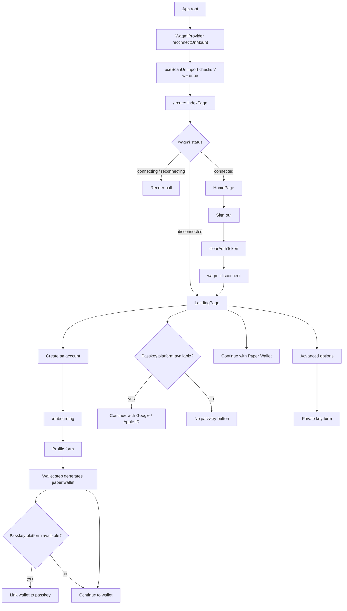
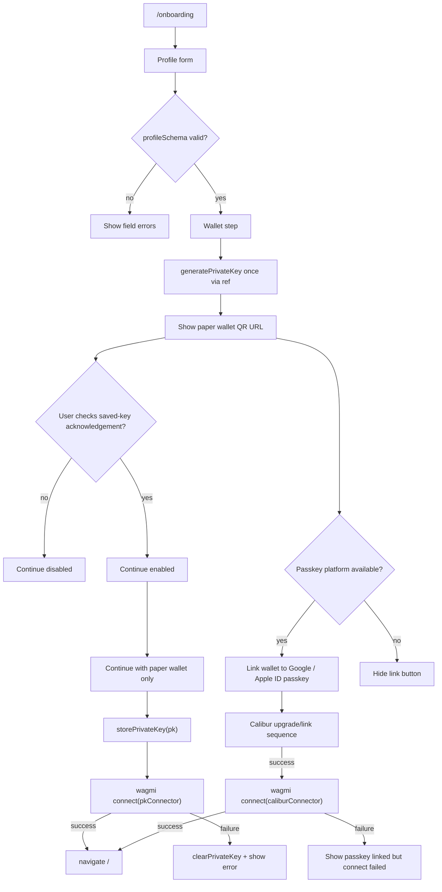
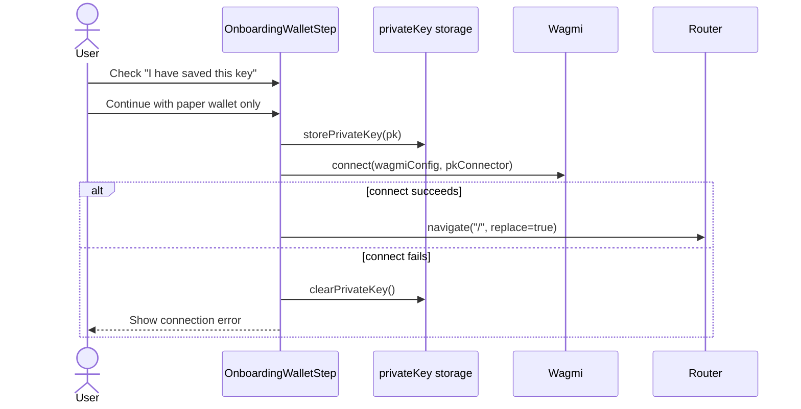
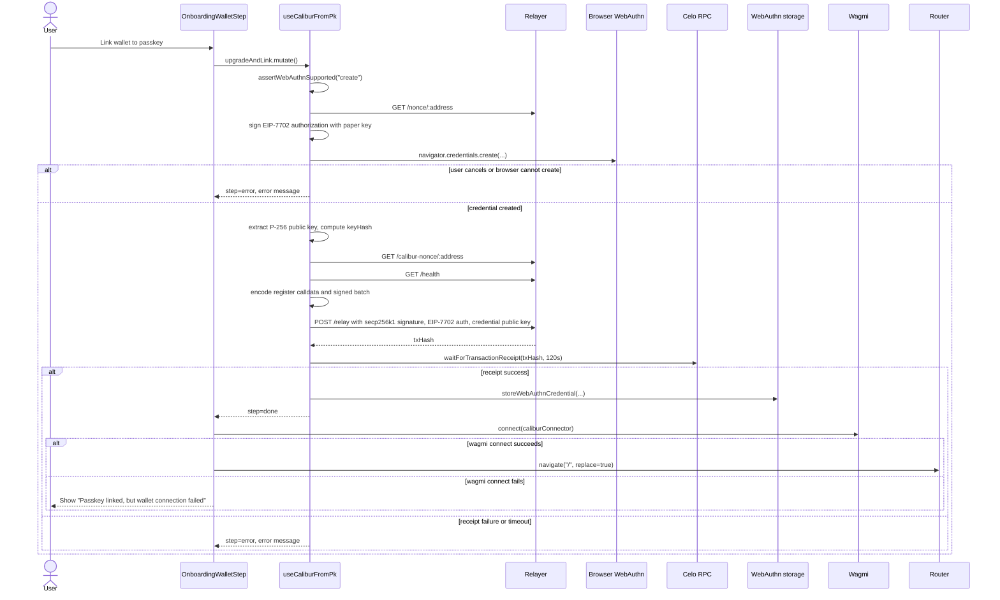
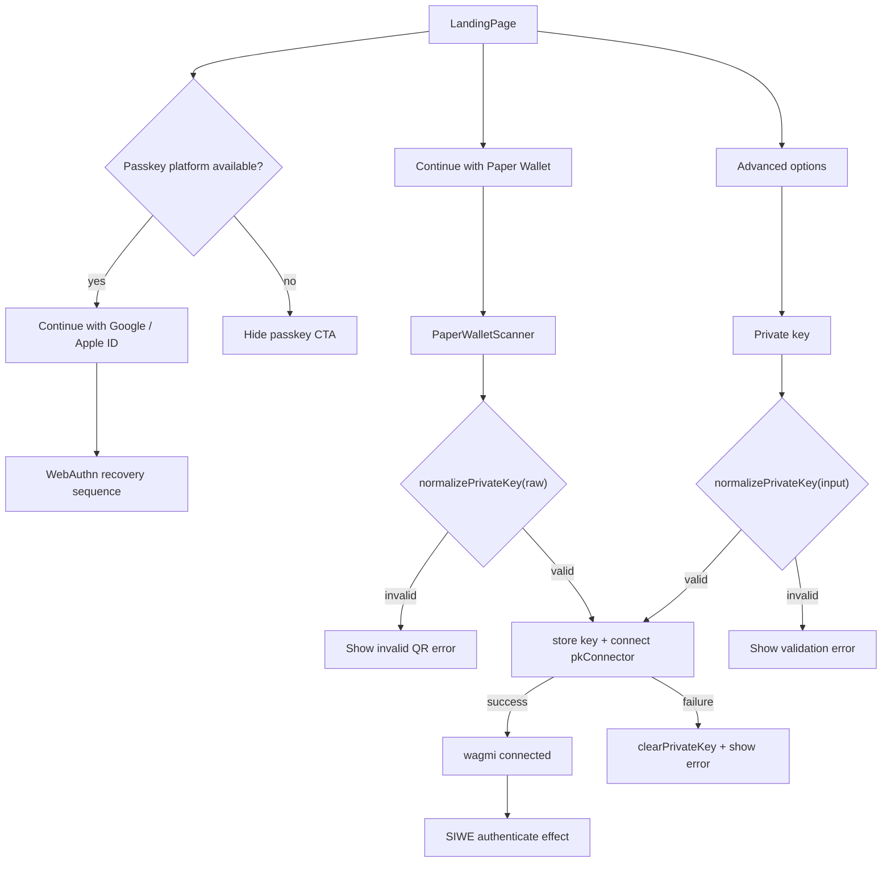
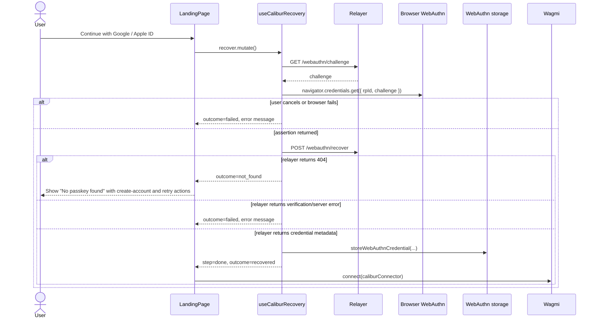
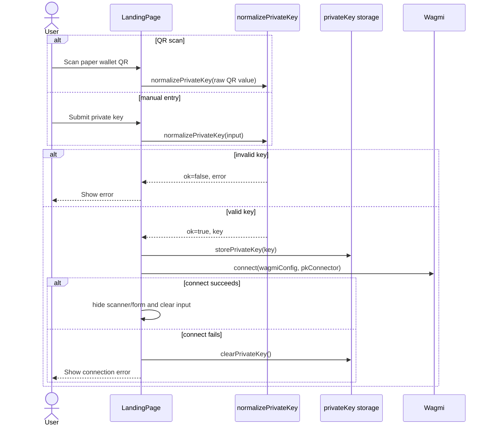
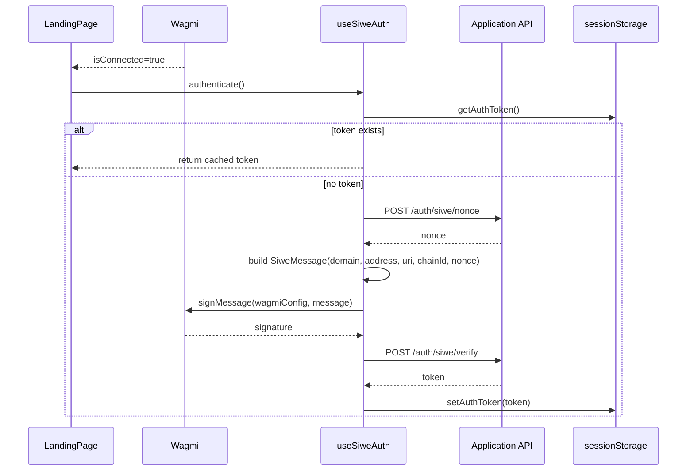
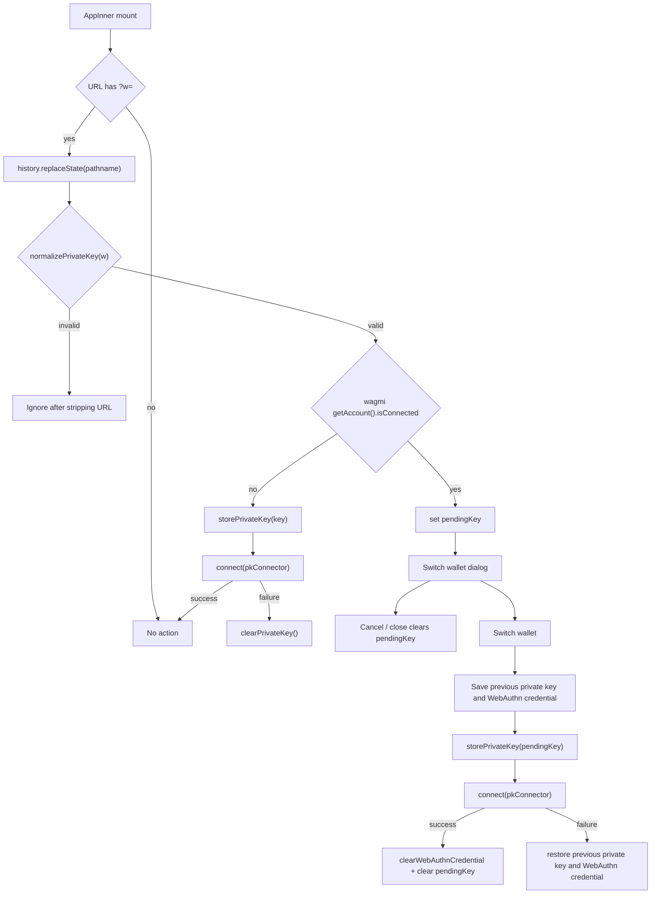

# Authentication Flow

Client-side authentication and wallet connection flows.

## Current Auth Model

The app treats wallet connection as the primary gate:

- `/` renders `HomePage` when `useAccount()` is connected.
- `/` renders `LandingPage` when disconnected.
- `/onboarding` renders `OnboardingFlow`.
- `WagmiProvider` is configured with only two connectors:
  - `private-key`, backed by a stored paper-wallet key.
  - `calibur-webauthn`, backed by a stored WebAuthn credential.

SIWE is separate from wallet connection:

- `LandingPage` calls `useSiweAuth().authenticate()` after wagmi reports
  `isConnected`.
- The SIWE JWT is stored in `sessionStorage` under `clc_auth_token`.
- `HomePage` currently only requires wallet connection, not a SIWE token.
- On sign-out, `HomePage` clears the SIWE token and calls wagmi disconnect.

## Storage

| Data                        | Storage          | Key                | Written by                | Cleared by                                              |
| --------------------------- | ---------------- | ------------------ | ------------------------- | ------------------------------------------------------- |
| Paper-wallet private key    | `localStorage`   | `clc_pk_raw`       | `storePrivateKey`         | `clearPrivateKey`, private-key connector disconnect     |
| Paper-wallet connected flag | `localStorage`   | `clc_pk_connected` | `storePrivateKey`         | `clearPrivateKey`                                       |
| Paper-wallet address        | `localStorage`   | `clc_pk_address`   | `storePrivateKey`         | `clearPrivateKey`                                       |
| WebAuthn credential         | `localStorage`   | `clc_webauthn`     | `storeWebAuthnCredential` | `clearWebAuthnCredential`, Calibur connector disconnect |
| SIWE JWT                    | `sessionStorage` | `clc_auth_token`   | `setAuthToken`            | `clearAuthToken`, browser session end                   |

## Overall UI Flow

## Onboarding Flow

Onboarding is two client-side steps:

1. `OnboardingProfileForm` validates profile input.
2. `OnboardingWalletStep` generates a new private key and presents it as a
   paper wallet.

The current profile data is not persisted during the active onboarding path.
`OnboardingProfileForm` logs profile data and passes it to the wallet step.
`OnboardingWalletStep` logs it again when continuing with the paper wallet.
`submitSignupProfile` exists, but the current onboarding UI does not call it.

### Onboarding: Paper Wallet Only

### Onboarding: Link Paper Wallet To Passkey

This path upgrades the generated paper-wallet key into a Calibur smart account
and stores the WebAuthn credential locally.

## Sign-In Flow

The landing page exposes three sign-in paths:

- Passkey recovery, when platform passkeys are available.
- Paper-wallet QR scan.
- Manual private-key entry under advanced options.

### Sign-In: Passkey Recovery

### Sign-In: Paper Wallet QR Or Manual Private Key

### SIWE After Connection

SIWE currently runs only from `LandingPage`. If the user lands on `/` already
connected after wagmi reconnects and `IndexPage` renders `HomePage`, this
component-level SIWE effect does not run.

## Paper-Wallet URL Import

Every page under the root route runs `useScanUrlImport()` once on mount. It
looks for `?w=<key>`, strips the query parameter, validates the key, and then
either connects or asks for confirmation.

## Connector Behavior

### Private-Key Connector

The `private-key` connector reads the stored key from `localStorage` and derives
the account address with `privateKeyToAccount`.

Supported provider methods:

- `eth_accounts`
- `eth_requestAccounts`
- `eth_chainId`
- `personal_sign`
- `eth_signTypedData_v4`
- `eth_sendTransaction`
- fallback to the viem wallet client request

Explicitly unsupported:

- `eth_sign`

Connect fails if no key is stored. Disconnect clears the private-key storage.

### Calibur WebAuthn Connector

The `calibur-webauthn` connector reads a stored WebAuthn credential from
`localStorage`.

Supported provider methods:

- `eth_accounts`
- `eth_requestAccounts`
- `eth_chainId`
- `eth_sendTransaction`

Unsupported signing methods:

- `personal_sign`
- `eth_sign`
- `eth_signTypedData_v4`

Transaction sending calls `sendCaliburTransaction`, which:

1. Reads the stored credential.
2. Fetches relayer health and Calibur nonce.
3. Builds an EIP-712 digest for the batch.
4. Prompts WebAuthn with the digest as the challenge.
5. Encodes the WebAuthn signature.
6. Relays the transaction through `POST /relay`.

Connect fails if no credential is stored or the stored credential is marked
`stale`. Disconnect clears the WebAuthn credential.

## Edge Cases

### Platform And Browser Support

| Scenario                                                | Current behavior                                                                         |
| ------------------------------------------------------- | ---------------------------------------------------------------------------------------- |
| Browser has no platform passkey support                 | Landing page hides the passkey sign-in button; onboarding hides the link-passkey button. |
| Browser supports passkeys but WebAuthn create/get fails | Hook sets `step=error`; UI shows the error message.                                      |
| Passkey create is cancelled                             | Treated as an error: `Passkey creation cancelled`.                                       |
| Passkey assertion is cancelled                          | Treated as an error: `WebAuthn assertion cancelled`.                                     |
| `VITE_RELYING_PARTY_ID` is a URL                        | `resolveRelyingPartyId` normalizes it to the hostname.                                   |
| No relying-party env and no browser hostname            | Falls back to `localhost`.                                                               |

### Onboarding

| Scenario                                                      | Current behavior                                                                             |
| ------------------------------------------------------------- | -------------------------------------------------------------------------------------------- |
| Profile is invalid                                            | Field-level validation errors prevent advancing to wallet step.                              |
| User goes back from wallet step                               | Returns to profile step; generated key is discarded when the wallet step unmounts.           |
| User does not acknowledge saving the paper wallet             | Continue button remains disabled.                                                            |
| Download card fails                                           | Shows `Download failed. Try a screenshot instead.`                                           |
| Paper-wallet connection fails during onboarding               | Clears private-key storage and shows the error.                                              |
| Passkey upgrade relayer call fails                            | `useCaliburFromPk` sets `step=error` and displays the error.                                 |
| Passkey registration transaction fails on-chain               | Throws `Passkey registration transaction failed on-chain`.                                   |
| Passkey registration succeeds but wagmi Calibur connect fails | WebAuthn credential remains stored; UI shows `Passkey linked, but wallet connection failed.` |
| User links passkey successfully                               | Stores WebAuthn credential and navigates home after Calibur connector connects.              |

### Sign-In

| Scenario                                           | Current behavior                                                                  |
| -------------------------------------------------- | --------------------------------------------------------------------------------- |
| Passkey recovery returns 404 from relayer          | UI shows `No passkey found`, with create-account and retry actions.               |
| Passkey recovery returns verification/server error | UI shows relayer description or generic recovery error.                           |
| Passkey recovery succeeds                          | Stores WebAuthn credential and connects Calibur connector.                        |
| QR code has no valid private key                   | UI shows `This QR code does not contain a valid private key.`                     |
| Manual private key is blank or malformed           | UI shows validation error from `normalizePrivateKey`.                             |
| Private-key connect fails                          | Clears private-key storage and shows the connection error.                        |
| SIWE nonce/sign/verify fails                       | Error is caught in `LandingPage` and logged to console; wallet remains connected. |
| SIWE token already exists in session storage       | `authenticate()` returns cached token without signing.                            |

### Paper-Wallet URL Import

| Scenario                                      | Current behavior                                                                                |
| --------------------------------------------- | ----------------------------------------------------------------------------------------------- |
| URL has no `?w=`                              | No action.                                                                                      |
| URL has invalid `?w=`                         | Query param is stripped, then ignored.                                                          |
| URL has valid `?w=` while disconnected        | Stores key and attempts `pkConnector` connect silently.                                         |
| Silent URL connect fails                      | Clears private-key storage.                                                                     |
| URL has valid `?w=` while already connected   | Opens switch-wallet dialog with derived address.                                                |
| User cancels switch dialog                    | Clears pending key only. Existing wallet remains connected.                                     |
| User confirms switch and new connect succeeds | Stores new private key, connects `pkConnector`, clears WebAuthn credential, clears pending key. |
| User confirms switch and new connect fails    | Restores previous private key and previous WebAuthn credential if they existed.                 |

### Disconnect And Reconnect

| Scenario                                | Current behavior                                                                   |
| --------------------------------------- | ---------------------------------------------------------------------------------- |
| User signs out from `HomePage`          | Clears SIWE session token and calls wagmi `disconnectAsync()`.                     |
| Disconnecting private-key connector     | Clears private-key localStorage keys.                                              |
| Disconnecting Calibur connector         | Clears WebAuthn credential localStorage key.                                       |
| Wagmi reconnects on mount               | `IndexPage` may render `HomePage` directly when connected.                         |
| Wagmi reconnects directly to `HomePage` | `LandingPage` SIWE effect does not run, so SIWE may not be refreshed in that path. |

## Known Refinement Points

Gaps and sharp edges in the current implementation:

- Profile persistence is not wired into the active onboarding flow.
  `submitSignupProfile` exists but is unused by `OnboardingFlow`.
- SIWE is currently opportunistic and tied to `LandingPage`, not to the global
  connected state. A reconnect path can reach `HomePage` without re-running
  SIWE.
- A successful passkey link stores the WebAuthn credential before the follow-up
  wagmi Calibur connect succeeds. If that connect fails, the credential remains
  available for retry.
- Paper-wallet URL import silently connects when disconnected. Opening a valid
  `?w=` URL mutates wallet storage immediately.
- Switching to a paper wallet explicitly clears the WebAuthn credential on
  success, making the paper-wallet key the active local auth method.
- WebAuthn credentials can be marked stale, but no active flow in the current
  UI calls `markWebAuthnStale`.
