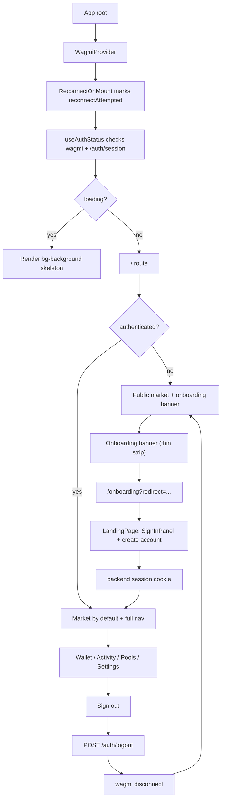

# Authentication Flow

Client-side authentication and wallet connection flows.

## Current Auth Model

The public market is the default route. Wallet connection alone is not enough to unlock private app actions.

A user is authenticated only when both are true:

1. wagmi has a connected wallet; and
2. `GET /auth/session` returns a session whose `address` matches the connected wallet.

`GET /auth/session` is the frontend source of truth for backend auth state:

- `204` means no valid backend session.
- `200 { address, chainId }` means a valid cookie session exists.
- network/5xx errors are treated as `sessionCheckError`, not as guest state.

The app still supports two wallet connectors:

- `private-key`, backed by a stored paper-wallet key.
- `calibur-webauthn`, backed by a stored WebAuthn credential.

There are two authentication mechanisms, and they create a backend session differently:

- **Private key / paper wallet** (`private-key`): anyone can load a raw key, so the
  client proves control with a **SIWE signature** (`/auth/signin`). The recovered EOA
  signs a nonce; the backend ecrecovers it and issues the session cookie.
- **Passkey** (`calibur-webauthn`): the WebAuthn assertion is itself the authentication
  (device-bound credential + user verification). No SIWE is involved — the client gets a
  challenge, the authenticator signs it, and the backend verifies the P-256 assertion at
  `POST /auth/webauthn/verify`, then issues the session cookie. The connector still cannot
  sign arbitrary SIWE messages, and it never needs to.

In both cases the result is the same `__clc_auth` cookie and the normal `authenticated`
state from `/auth/session`.

## Auth States

| State                | Meaning                                                                                            | UI behavior                                                                                                         |
| -------------------- | -------------------------------------------------------------------------------------------------- | ------------------------------------------------------------------------------------------------------------------- |
| `loading`            | Reconnect has not been attempted, wagmi is connecting/reconnecting, or `/auth/session` is pending. | Render a minimal skeleton. Do not flash the guest banner.                                                           |
| `guest`              | Reconnect settled and no wallet is connected.                                                      | Show public market + onboarding banner. Hide private tabs/routes.                                                   |
| `connectedNoSession` | Wallet is connected but `/auth/session` is missing or belongs to another address.                  | Keep wallet connected and offer re-auth: SIWE for EOA connectors, a fresh passkey assertion for `calibur-webauthn`. |
| `authenticated`      | Wallet is connected and `/auth/session.address` matches.                                           | Show full app navigation and private routes.                                                                        |
| `sessionCheckError`  | Session check failed due to network/server error.                                                  | Show retry. Do not silently demote already-mounted private UI to guest.                                             |

## Storage

| Data                        | Storage         | Key                | Written by                                                         | Cleared by                                              |
| --------------------------- | --------------- | ------------------ | ------------------------------------------------------------------ | ------------------------------------------------------- |
| Paper-wallet private key    | `localStorage`  | `clc_pk_raw`       | `storePrivateKey`                                                  | `clearPrivateKey`, private-key connector disconnect     |
| Paper-wallet connected flag | `localStorage`  | `clc_pk_connected` | `storePrivateKey`                                                  | `clearPrivateKey`                                       |
| Paper-wallet address        | `localStorage`  | `clc_pk_address`   | `storePrivateKey`                                                  | `clearPrivateKey`                                       |
| WebAuthn credential         | `localStorage`  | `clc_webauthn`     | `storeWebAuthnCredential`                                          | `clearWebAuthnCredential`, Calibur connector disconnect |
| Backend session             | HttpOnly cookie | `__clc_auth`       | backend `/auth/signin` (SIWE) or `/auth/webauthn/verify` (passkey) | backend `/auth/logout`, expiry                          |

The old `sessionStorage` token store was removed; requests use the HttpOnly cookie.

## Overall UI Flow



## Public Market

`/` is public and renders the market map. Guests can browse marketplaces, shops, and offerings. Private tabs are hidden for guests. If a guest requests `/?tab=wallet`, the UI falls back to market and replaces the URL with the public tab.

The guest banner is a thin announcement strip at the top of the market
(`onboarding-banner.tsx`). It is purely an entry point: tapping it navigates to
`/onboarding` (preserving a validated `redirect` when there is private intent). It
contains no inline auth. The `/onboarding` route renders the `LandingPage` auth entry,
which handles both sign-in (`SignInPanel`) and the start of sign-up; language/theme
controls live there via `OnboardingMenu`.

## Sign-In Panel

`SignInPanel` lives in `apps/web/src/components/auth/` so it can be shared by route guards and the onboarding entry without sibling feature UI imports.

It accepts callbacks instead of hard-coding navigation:

```tsx
<SignInPanel onAuthenticated={closeSheetOrRenderGuardedRoute} />
```

Behavior:

- Private key / paper wallet: call backend SIWE sign-in first, then store/connect the private-key connector.
- Encrypted paper wallet: decrypt, then use the same private-key path.
- `404` from `/auth/signin`: send the user to sign-up, preserving a validated internal `redirect`.
- `403`: show approval pending/rejected UI.
- Passkey (`calibur-webauthn`): collect a WebAuthn assertion and call
  `POST /auth/webauthn/verify` (no `signMessage`, no SIWE). On success, store the recovered
  credential, connect the Calibur connector, and finish authenticated. `404`/`403` reuse the
  sign-up / approval branches above.

## Private Route Guard

Wallet routes under `/wallet/**` are wrapped with `AuthenticatedRoute`.

The guard does not redirect for sign-in. It renders an auth-required screen at the same URL. Once the user signs in, `useAuthStatus` changes to `authenticated` and the originally requested route renders automatically.

For sign-up, the guard navigates to `/onboarding?redirect=<current internal path>`. The redirect is validated to accept only internal paths beginning with `/` and reject external/protocol-relative URLs.

## Onboarding Flow

Onboarding remains a two-step client flow:

1. `OnboardingProfileForm` validates profile input.
2. `OnboardingWalletStep` generates a paper wallet and signs up with the backend.

`/onboarding` behavior:

- loading auth state: skeleton;
- authenticated: replace to `redirect ?? '/'`;
- guest or connected-without-session: render the `LandingPage` auth entry, then the
  profile/wallet sign-up flow once the user chooses to create an account.

On successful onboarding, the flow navigates to the validated redirect if present; otherwise it returns to `/` market.

## Re-authentication

When wagmi has a connected EOA-capable wallet but `/auth/session` is missing or stale, the UI offers “Re-authenticate.” This calls `useBackendWalletSignin(address, chainId)` and invalidates the auth session query on success. The wallet is not disconnected automatically when the cookie expires.

For Calibur/passkey connectors, re-authentication does not use SIWE (the connector cannot
sign arbitrary messages). Instead the UI prompts for a fresh WebAuthn assertion and calls
`POST /auth/webauthn/verify`, which re-issues the session cookie.

## Paper-Wallet URL Import

`useScanUrlImport()` checks `?w=<key>` once on root mount and strips the parameter.

New behavior:

- guest + raw/encrypted `?w=`: show an explicit import/sign-in prompt; do not silently connect;
- authenticated + raw `?w=`: show the switch-wallet dialog;
- invalid `?w=`: strip and ignore.

The import flow signs in with the backend before connecting the private-key connector.

## Global 401 Handling

App-level React Query error handling watches for `BackendApiError` with `status === 401` or `code === 'E06'`. When seen, it invalidates `['auth', 'session']`. `useAuthStatus` then moves the UI to `connectedNoSession` so the user can re-authenticate.

## Connector Behavior

### Private-Key Connector

Reads the stored key from `localStorage` and derives the account with `privateKeyToAccount`.

Supported provider methods include:

- `eth_accounts`
- `eth_requestAccounts`
- `eth_chainId`
- `personal_sign`
- `eth_signTypedData_v4`
- `eth_sendTransaction`

### Calibur WebAuthn Connector

Reads a stored WebAuthn credential from `localStorage`.

Supported provider methods include:

- `eth_accounts`
- `eth_requestAccounts`
- `eth_chainId`
- `eth_sendTransaction`

Unsupported signing methods:

- `personal_sign`
- `eth_sign`
- `eth_signTypedData_v4`

The connector cannot sign arbitrary SIWE messages, and it does not need to: passkey
authentication uses the WebAuthn assertion verified at `POST /auth/webauthn/verify`, which
issues the session cookie directly. SIWE remains the path for raw private-key / paper-wallet
connectors only.

## Backend Dependencies

Implemented in `clc-core` for this revamp:

- `POST /auth/webauthn/verify` — verifies a WebAuthn assertion against the stored credential
  and issues the `__clc_auth` session cookie for a registered + approved user (404 not
  registered, 403 pending/rejected, 401 assertion failed). This is the WebAuthn assertion
  session endpoint the frontend depends on. **Requires deploying `clc-core` to staging.**

Open backend decisions:

1. Product/backend must choose legacy split auth (`/auth/signin` + `/auth/signup`) versus unified `/auth/siwe/verify` with pending approvals.
2. Production cookie settings must match app/API domain topology.
3. `/auth/session` may later include profile-completion metadata to avoid an extra profile check.
