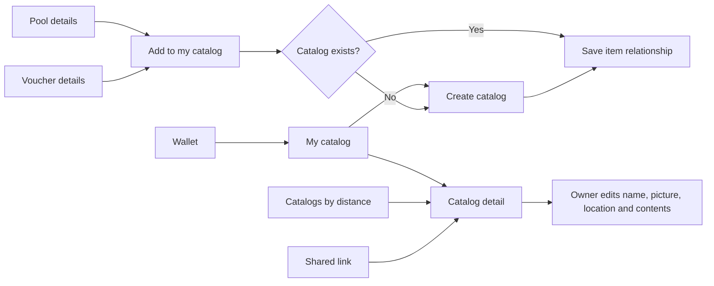

# User-created catalogs: scope and execution plan

Updated: 2026-10-10. Status: code complete locally; deployment and live browser
verification remain. The frontend screens/client and backend handlers/store/
migration exist. All 12 catalog operations are now registered, and the catalog
API/store/migration tests pass against an isolated local PostgreSQL database.

## Confirmed scope

- A catalog is a database entity that can contain pools and vouchers.
- Catalog creation, editing and membership are database operations.
- The wallet has a My catalog entry/section with a picture and editable name.
- A person can create one catalog in v1. My catalog means the collection they
  curate, not catalogs they follow/save. Preserve a path to several catalogs.
- The creator can edit their catalog, including its name and picture.
- The creator can add any publicly visible pool or voucher, not only their own.
- Each catalog has its own location, selected during creation/editing.
- Viewing follows the same public/guest rules as vouchers and pools.
- Pool and voucher surfaces offer Add to catalog.
- Adding a pool adds only the pool. Its vouchers are not automatically added;
  individual vouchers can be curated separately.
- A catalog can be shared socially.
- A Catalogs wallet action button opens `/catalogs`, where catalogs are listed
  by distance. This interprets answer 5 as accepting the proposed wallet action
  placement.
- Signed-in discovery follows the existing 1,000 km saved-profile radius.
- Native sharing/copy link is sufficient; rich social previews are not needed.
- Reuse established frontend and backend patterns.

The current code also calls the general pool/voucher directory a “catalog.”
That existing directory and its filters remain separate from this new entity.
Use `features/catalogs` for the new feature; retain existing singular
`features/catalog` search/filter helpers.

## Planned behavior

Use My catalog as the wallet section label, with the catalog's editable name on
its pictured row and detail screen. With no catalog, show Create catalog. With
one catalog, show that catalog and its edit action; do not show a second-create
action or a catalog chooser.

The catalog creator can add any publicly visible pool or voucher. A pool or
voucher can appear in several catalogs. Adding the same item twice has no extra
effect. Adding a pool adds only its pool relationship. Adding or removing a pool
never changes explicit voucher entries; later changes to a pool's vouchers do
not change the catalog's voucher entries. Individual item removal is included
as normal curation; removal removes the catalog relationship only, never the
pool or voucher itself.

Catalogs are public and shared links open without sign-in. Creation, editing,
and membership changes require an authenticated owner. Each catalog has a
stable ID in its URL, so renaming it does not break shared links.

The creator sets the catalog's location with the existing location picker,
initially suggested from their saved profile. Later profile edits do not move
the catalog. Name and location are required; picture can use a fallback until
uploaded. Description, privacy controls, following, manual reordering, catalog
deletion, and admin management are not assumed requirements.

With an existing catalog, Add to catalog adds directly and shows saved/already
added state. Without one, it opens creation with the selected item retained as a
typed navigation intent. After creation, add the item and return to its source.
If creation succeeds but adding fails, retry against that catalog; do not create
another one. Only mark an item added after the backend confirms the write.

## Implementation defaults

Picture is optional with a fallback, names are
Unicode display labels rather than unique addresses, ordinary guest browsing
has deterministic ID ordering with no invented distance, and whole-catalog
deletion stays outside v1. Signed-in users without a valid location see the
existing location prompt; session/profile failures show retry rather than an
unmarked global list. Direct detail links follow pool/voucher detail access,
not the nearby list radius.

## Existing patterns to reuse

| Concern           | Source / constraint                                                                                                                                    |
| ----------------- | ------------------------------------------------------------------------------------------------------------------------------------------------------ |
| Wallet section    | `apps/web/src/features/home/ui/wallet-page.tsx`; follow owned-pool section conventions                                                                 |
| Owner editing     | `apps/web/src/features/pools/ui/pool-profile-editor-sheet.tsx`; existing sheet, TanStack Form and zod                                                  |
| Images            | `ImageUploadField`, `useImageUpload`, shared image query factories; existing storage token and upload service, persist returned absolute URL           |
| Location          | `LocationPicker`, existing coordinate validation and nearby boundary                                                                                   |
| Sharing           | `ShareVoucherButton` in `components/vouchers/voucher-sheet.tsx`; native share, cancellation handling, fresh Copy link tap after failure                |
| Server state      | `packages/api` resource client/query factories; register client through `createClcApi`; use account-scoped keys for My catalogs                        |
| Successful writes | `use-update-pool-profile.ts`; seed saved detail, invalidate affected lists and counts                                                                  |
| Authentication    | `docs/AUTH.md`; connected wallet alone is insufficient; backend session enforces ownership                                                             |
| UI and navigation | Thin routes, typed URL state, existing navigation shell and Back behavior; shared add control in app components to respect feature boundaries          |
| Presentation      | Existing mobile square surfaces, fonts, Lingui, RTL and Unicode text rules                                                                             |
| Backend           | `clc-core/internal/api/pool_profile_handler.go`; authorize and mutate transactionally                                                                  |
| Database          | `clc-core/migrations/006_network_catalog.sql`, `017_send_message_shares.sql`; integer identities, user ownership, foreign keys and relationship tables |

Planning used checked-out source. Older supporting docs can describe planned or
superseded behavior; recheck the target branches before implementation.

## Execution sequence

### 1. Lock the contract

Define the create/update payload and responses together
across repositories: required name/location, optional image URL, owner summary,
timestamps, item counts and paginated members. Match field limits to the
existing text/location/image validators. Reuse existing error envelopes for
invalid input, authentication, forbidden writes, missing records and conflicts.

Proposed routes: `/catalogs`, `/catalogs/$catalogId`, `/catalogs/create`, and
`/wallet/catalogs` only if a separate management page is needed. For v1 the
wallet row can open `/catalogs/$catalogId` directly; owner editing uses the
existing sheet pattern. Reserve plural resource routes so supporting several
catalogs later does not require replacing detail links.

Acceptance: both repositories implement the same wire contract, and examples
cover no catalog, an empty catalog, existing items and second-create conflict.

### 2. Backend database and APIs

Add a new incremental migration in the separate `clc-core` repo, choosing its
number at implementation time:

- `catalogs`: ID, owner user ID, name, image URL, location name/coordinates,
  timestamps. Add a named unique constraint on owner user ID for the v1 limit.
- `catalog_pools`: catalog ID and existing pool ID, unique as a pair.
- `catalog_vouchers`: catalog ID and existing voucher ID, unique as a pair.

The unique owner constraint enforces the limit under concurrent requests; a
frontend check alone is insufficient. Translate the constraint violation into
the existing conflict response and refetch My catalog. The table's primary key
is the catalog ID, not the owner ID. Future multiple-catalog support removes
that one constraint, changes the creation policy, and adds a chooser; existing
catalog/member identities and links survive unchanged.

Use the current store/query system, API envelopes, validation, rate limits and
session middleware. Derive owner from the session. Lock/check ownership in the
same transaction as metadata and relationship writes. Resolve pool/voucher
references with their existing chain-aware identity rather than names. Preserve
existing resource visibility rules in member reads and additions.

Proposed endpoints, using existing API envelopes:

| Endpoint under `/api/v2`                                | Behavior                                                                    |
| ------------------------------------------------------- | --------------------------------------------------------------------------- |
| `GET /catalogs`                                         | Public list; `nearby=true` uses session/profile and nearest-first ordering  |
| `GET /catalogs/:id`                                     | Public metadata and visible member counts                                   |
| `GET /catalogs/:id/pools`, `GET /catalogs/:id/vouchers` | Paginated visible members                                                   |
| `GET /users/me/catalogs`                                | Session-owned list, zero or one entry in v1; no radius filter               |
| `POST /catalogs`                                        | Authenticated creation; owner comes from session; second creation conflicts |
| `PUT /catalogs/:id`                                     | Owner updates name, picture and location; returns saved row                 |
| `GET /catalogs/:id/membership?kind=pool&resourceId=123` | Owner checks one item's membership; kind also accepts `voucher`             |
| `PUT/DELETE /catalogs/:id/pools/:poolId`                | Owner adds/removes an existing database pool reference                      |
| `PUT/DELETE /catalogs/:id/vouchers/:voucherId`          | Owner adds/removes an existing database voucher reference                   |

Member IDs resolve to the existing chain-aware records. Never infer authorization
from IDs or accept an owner supplied in the payload. Duplicate additions and
repeated removals are idempotent. Return current resource summaries instead of
copied pool/voucher metadata. Counts and lists use identical visibility rules.

The existing nearby backend filters by distance but pool pages order by ID.
For nearest-first catalogs, calculate and order by distance before pagination,
with ID as a tie-breaker. Cursor contents must match that ordering and origin;
reset pagination when the origin changes. Reuse existing coordinate validation,
radius policy and cursor conventions, not page-local sorting.

Acceptance: database-backed tests prove one-catalog enforcement under concurrent
creation, owner-only writes, foreign-key integrity, idempotent membership and
nearest-first pagination, including ties and the radius boundary.

### 3. Shared frontend contracts

Add pure schemas/types under `packages/core/src/features/catalogs/logic`.
Add the resource client, query keys/options and mutation behavior under
`packages/api/src/features/catalogs`. Keep public, nearby and owner reads
separate in transport/cache identity. Clear private query state through the
existing identity reset path. No server-data copies in Zustand.

Use the existing `["clc", ...]` query prefix so identity reset clears these
reads. Include viewer/location scope in nearby keys. After metadata writes,
seed detail and invalidate owned/discovery lists. After membership writes,
invalidate member pages, counts and add-button membership state. Fetch membership
when needed rather than downloading the full catalog on every detail visit.

Acceptance: client tests cover payloads/errors/cursors and mutation tests prove
the wallet, detail and discovery views refresh after changes.

### 4. Catalog screens and wallet integration

Implement create/detail/edit and My catalog, including the picture flow.
Then add a shared Add to catalog control to pool and voucher details and
implement member removal. Keep item links opening existing pool and
voucher surfaces. Cover loading, empty, error, unauthorized, deleted/missing
resource, upload failure and duplicate-add states. Preserve existing share and
pool/voucher actions. Reuse resource row/card components at a permitted shared
boundary rather than importing another feature's `ui/`.

Acceptance: a person creates one catalog, edits it, adds/removes eligible items
and sees updates immediately; another person can view but cannot edit. Creation
from an item returns correctly and recovers if the catalog already exists.

### 5. Discovery and sharing

Implement nearest-first `/catalogs` and the confirmed navigation entry.
Use one location origin for eligibility, sorting and displayed distances.
Add stable detail links and native share/copy-link behavior. Reuse the existing
guest/public discovery and nearby notice. Add Catalogs to the wallet action area
with a mobile layout that keeps all five actions legible and accessible.

Acceptance: guests open shared links; authenticated discovery orders results
within 1,000 km of the saved profile; renaming retains the shared URL. Copy-link
fallback works and cancelling native share does not display an error.

### 6. Verification and rollout

- Backend database/API tests: concurrent second creation, owner versus non-owner/anonymous writes, invalid
  members, duplicate add, scoped removal, invalid coordinates/image URL, public
  visibility, distance ties and ordering across page boundaries.
- Membership regression: adding a pool creates no voucher entries; removing a
  pool preserves separately added vouchers; later pool membership changes do
  not affect the curated catalog's voucher entries.
- Frontend tests: create/edit/upload, wallet cards, direct-add/create-first return,
  cache refresh after membership changes, session/account switching, direct
  shared links, share cancellation/fallback, and Back navigation.
- Manual mobile verification at 360 and 430 px, guest and signed-in behavior,
  long Unicode names and RTL.
- Run `pnpm i18n:extract`, fill supported translations, `vp check` and relevant
  `vp test` suites. Run backend tests with a test database (`make test` serializes
  database-using packages); report unavailable database tests explicitly.
- Deploy compatible backend migration/APIs before enabling frontend callers.
  No smart-contract deployment is involved.

Suggested delivery slices: (1) backend migration/store/API and database tests;
(2) shared client/contracts plus create/edit/detail and My catalog; (3) pool and
voucher curation controls; (4) discovery/navigation/sharing and complete mobile
verification. Each slice uses the existing patterns above and remains reviewable.

## Planning verification

Inspection covered frontend guidance, authentication/query docs, wallet, nearby
browsing, pool editing, image upload, voucher sharing and backend migration/auth/
store patterns. The user's 2026-10-10 answers establish the scope above, including
the clarification that adding a pool adds only the pool. No product clarification
remains pending. Architectural decisions are recorded in
[[2026-10-10-user-catalogs]].

## Earlier implementation verification (historical snapshot)

These results predate the completion review below. They must not be used to claim
the current working tree is complete. In particular, earlier backend integration
passes in `clc-core/docs/CATALOGS.md` predate the missing route registrations.

- Shared API suite: 480 tests passed; core domain suite: 648 tests passed.
- Locale suite: 28 tests passed. Lingui extraction reports zero missing messages
  in all 11 supported locales.
- Catalog UI tests cover direct add, create-first partial failure/retry, edit,
  owner-only controls, scoped removal, account changes, public and nearby
  discovery, missing profile coordinates, share cancellation and copy fallback.
- Charlotte browser verification with mocked API responses: guest list/detail
  at 360 and 430 px, long names wrap, no horizontal overflow, owner edit hidden.
  The staging backend does not yet serve these new endpoints; these screenshots
  verify the frontend contract and layout, not a deployed end-to-end flow.
- `vp check --fix` passes with the existing reports `no-control-regex` warning.
- Full web suite with `--maxWorkers=2`: 229 files and 2,238 tests passed. The first
  unconstrained run exhausted worker startup capacity; limiting workers resolved
  it. The route-policy inventory now includes all three catalog routes.

## Completion review and resolution — 2026-10-10

The review found one functional blocker: the catalog handlers were not registered
with the HTTP router. The route registration, store refactor, and focused backend
acceptance tests are now implemented. No other missing frontend feature or
demonstrated backend store defect was found in the scoped inspection. The complete
browser flow against a running backend remains to be verified after rollout.

### Current status

| Area                   | Evidence and status                                                                                                                                                                                      |
| ---------------------- | -------------------------------------------------------------------------------------------------------------------------------------------------------------------------------------------------------- |
| Database               | Migration 047 defines catalogs, independent pool/voucher relations, unique owner constraint, foreign keys, coordinates and timestamps. Focused store and migration tests pass.                           |
| Handlers and store     | Create/update, reads, membership, validation, transactional ownership and nearby cursor logic exist. `curatedCatalogSaveHandler` is implemented.                                                         |
| HTTP registration      | All 12 operations are registered with the existing public, user and nearby middleware; the three API tests that previously failed with 404 now pass.                                                     |
| Repository conventions | Existing middleware, errors, SQL binding and scanning are reused. `ListCuratedCatalogs` now separates query composition and execution, following the other filtered list methods.                        |
| Frontend               | Shared schemas/client/cache, wallet entry, create/edit/detail/discovery, add/remove, sharing and image/location integrations exist. Focused tests pass.                                                  |
| Complete user flow     | Not yet verified against the real backend. Historical browser QA used mocked responses and covered guest list/detail only.                                                                               |
| Delivery               | Catalog files remain untracked in both repos. Include the migration, handlers, store, frontend modules and tests in the final change. Untracked files execute locally but will not ship unless included. |

### Fresh verification

- `pnpm exec vp test catalogs --maxWorkers=2`: 4 files, 25 tests passed.
- Separate targeted web run including the route-policy inventory: 2 files,
  15 tests passed; shared API catalog tests: 8 passed; core catalog tests: 3 passed.
  These runs overlap; their counts are not additive.
- With an isolated local PostgreSQL database and `CORE_TEST_DSN`,
  `go test -p 1 ./internal/api ./internal/store ./migrations -run 'TestCurated|TestMigration' -count=1`:
  API, store and migration packages all pass. The previously failing tests now
  reach the handlers and store.
- Existing `golangci-lint` checks for API/store/migrations report zero issues.
- Full backend `go test -p 1 ./...` passes when the 12 existing query-plan
  tests in `catalog_search_plan_db_test.go` are excluded. Those tests use
  `EXPLAIN (GENERIC_PLAN)`, which the local PostgreSQL 14.20 server rejects;
  run them on PostgreSQL 16+ before release. All catalog tests remain enabled.
- Final `golangci-lint run ./...` reports zero issues. `pnpm exec vp check`
  reports zero errors and the existing reports `no-control-regex` warning.
- Full frontend `pnpm exec vp test --maxWorkers=2` passes: 372 files and
  3,911 tests. jsdom printed its existing unimplemented `scrollTo`/navigation
  notices without failing the run.
- No production or staging deployment, full frontend build, or live browser
  acceptance run was performed in this review.

### 1. API registrations — complete

Register all 12 method/path operations using the existing router groups:

- Public: list, detail, pool members and voucher members. Reuse the Market
  rate limiter; the list also uses `nearbyCatalogAuth()` for `nearby=true`.
- User-only: create, update, membership check and four member PUT/DELETE
  operations. Use the existing protected group plus `requireUserAuth()`.
- My catalog: register `GET /users/me/catalogs` under `userGroup`.

The user-only guard is required: handlers derive ownership from user claims,
and owner ID zero means an unrestricted list at the store layer.

Acceptance: existing route and DB API tests pass; all public reads work as a
guest, all protected operations reject anonymous/service callers, and owner
checks reject another user. Cover each member method/kind in the route table.

### 2. List implementation refactor — complete

Follow `ListPoolsFiltered` / `composePoolPage` and `ListReportsFiltered` /
`composeReportPage`: extract `composeCuratedCatalogPage`, returning the existing
`composed` type. Keep `ListCuratedCatalogs` focused on execution, scanning and
error handling. Format the SQL across readable lines and name the owner argument
`ownerID`, documenting zero as the no-owner-filter value.

Share the duplicated distance-expression construction with the existing nearby
helper where appropriate, retaining its coordinate guard and indexable bounding
box. Keep inner/outer ordering visibly consistent. Preserve current cursor
semantics, bound values, visibility and sorting before pagination. Return scan
errors immediately; normalize only successful empty results.

This is maintainability work, not an observed pagination failure. Do not add a
query framework or change the API contract. Acceptance: existing distance/tie/
radius and ownership tests remain green after the refactor.

### 3. Focused backend acceptance tests — complete

Extend the existing API/store tests, rather than creating another test system:

- My catalog returns only the caller's catalog after several users create one.
- Non-owner DELETE is forbidden; removing an item from one catalog preserves
  another catalog's relationship to the same item.
- Member pagination works across pages; cursors from another catalog or resource
  kind are rejected. Public catalog continuation preserves descending ID order
  and ends correctly, including empty pages.
- Later changes to `pool_tokens` do not change explicitly curated vouchers.
- Invalid save bodies, coordinate/image errors and missing nearby profile
  coordinates produce the documented HTTP status and error envelope.

Existing tests already exercise concurrent second-create conflicts, duplicate
membership writes, active-voucher visibility, distance ties and radius boundaries.
Keep those tests and run database-using packages serially with a real test DSN.

### 4. Verify the complete frontend flow against the working backend — outstanding

The catalog UI suite mocks the router/Back control, image uploader and location
picker; the wallet suite mocks `MyCatalogSection`. Cache tests check invalidation
calls rather than refreshed mounted screens. These are verification gaps, not
proof that those integrations are broken.

Use the existing browser workflow with a local backend containing migration 047
and the registered API, then check:

- Create from the wallet and from both pool/voucher add actions; successful
  return to the source, duplicate-create recovery, and add retry without creating
  another catalog after partial success.
- Edit name, upload/clear image and change location; upload failure and disabled
  submission while uploading; saved values persist after reload.
- Add/remove pools and vouchers independently; detail counts, discovery and the
  wallet row refresh; account switching clears private views and controls.
- Guest shared links, non-owner controls, native share cancellation/copy fallback,
  direct authenticated create links and real Back history.
- Signed-in nearby browsing, missing profile location, next pages and origin
  changes. Check owner/create screens and all five wallet actions at 360/430 px,
  including long Unicode names and RTL.

Add focused tests where these checks expose a gap in regression coverage. Use
the existing auth, upload, router and query patterns.

### 5. Final checks and delivery

Run backend format/lint and the relevant DB suites on the final tree. Run
`pnpm exec vp check`, relevant frontend/domain/client/navigation suites, and
Lingui extraction/locale checks when strings change. Do not run a full build
automatically. Update this plan and `clc-core/docs/CATALOGS.md` with final results,
replacing stale readiness claims.

Include every required tracked and untracked file in the reviewable change.
Check migration numbering against the target backend branch before integration.
Deploy the backend migration/API before the frontend callers, then repeat the
core smoke flow in the target environment as part of the rollout. No deployment
is authorized by this review request alone.

Done means the routes respond, required tests and lint pass, the complete user
flow works with real API/storage responses, and remaining environment-specific
limitations are recorded. Follow the established Markdown API reference; no
Swagger additions or separate documentation-test infrastructure are part of this
feature.
