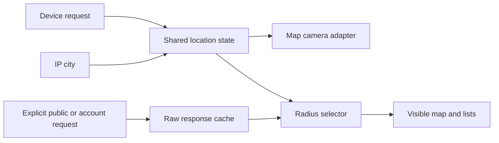

# Shared guest discovery location and public caches

Accepted 2026-10-17. This repairs the first guest visibility implementation.

Guests start at 500 km unless they saved another visibility. They can choose
Global. A device fix takes priority over an approximate IP city. A country or
fallback map camera is not a filtering origin. Without a usable origin, show
Use my location and Global. Do not prompt for device permission on entry.
An already granted permission can supply a fresh fix automatically.

## Ownership

`DiscoveryLocationProvider` is above the route outlet and radius boundaries.
It owns one device request stream, the current fix, IP fallback, request status,
and the explicit recenter sequence. Map cameras and radius filters consume this
same snapshot. GPS refresh retains the last fix while a request is pending.

A change of authenticated owner creates a new in-memory location store and
resets only its device controller. Routed pages and unsaved form state stay
mounted. Owner resolution uses the existing `useStorageOwner` policy; loading
and failed session checks do not become the guest persistence tier. Persisted GPS is read
after mount, scoped to that owner, and expires after 24 hours. Writes are best
effort. Storage events do not carry live application state. Blocked storage
must not prevent map and filter updates. IP cities never become precise distance
labels or a live user marker.

`useMarketCamera` adapts the shared state to camera priority and zoom. Its
constants and types live outside the map rendering module. Moving a map or
changing the radius does not create a new location request owner.

Map construction uses the already resolved camera's coordinates and zoom. The
Nairobi fallback applies only when no camera is available. Previously, returning
from Wallet created a map at Nairobi and applied the known camera after loading,
causing a visible jump. The constructor reads the current camera through a ref
so subsequent camera updates do not destroy and rebuild the map. Existing
camera priority, user-pan protection, and filter framing still apply after load.

## Request policy and cache identity

`NearbyRequest` is explicit: public (`nearby: false`) or authenticated nearby
(`nearby: true`, with an account/chain/location scope). API code does not parse
scope strings to decide request mode or credentials.

Public results are cached by server request inputs. Guest coordinates and radius
are view inputs and do not create another public cache entry. Query functions
return raw rows; selectors apply the current radius, including filtered searches
and pool candidates. This lets 50 → 500 km reveal cached rows without downloading
the same pages again. Authenticated nearby caches retain identity separation.
Discovery snapshots stay fresh for 60 seconds and unused for five minutes.
Consumers outside discovery retain their existing query policies.

## Pagination and facets

Suggestion queries inspect all retrieved pages. They automatically retrieve up
to six pages until the requested suggestion slots are filled or the cursor ends.
At the budget, Load more allows continuation. A failed page exposes retry and
retains earlier matches. Public results must not stop at the first distant row.
The existing complete-map and catalog safety caps remain in force.

Server facets remain search vocabulary. They do not describe the locally filtered
radius, so the filter sheet hides numeric facet counts while a radius applies.
Scalable public radius filtering before pagination and accurate local facet
counts need an explicit Core API extension. They are not implemented here.

## Guest entry

The welcome screen has a Market action. Completion updates the introduction
provider immediately, including when local persistence is blocked. Account
creation, sign-in, inline guidance, and Settings replay remain available.

## Verification

Regression coverage includes shared GPS refresh with blocked storage, owner
reset and an old callback, pending IP without a permission prompt, later-page
suggestions, page budget and retry, public cache reuse across radii, raw cached
search rows, and immediate guest entry. See the PR validation for command results.

Final verification: Node 24.16.0; type/lint/format checks pass. The full run
passed 4,327 tests and found five navigation fixtures missing the new location
boundary. After correcting those fixtures and adding form-preservation coverage,
the final focused run passed 106 tests in 13 files. Live browser verification
remains pending.

Map return regression: three tests first reproduced the Nairobi initialization
for live, profile, and restored cameras. After the fix, 167 tests across the map,
market page, and camera hook pass, including initial construction and remount
before tiles load. `vp check` passes on Node 24.16.0. Real-device visual
verification remains pending.
